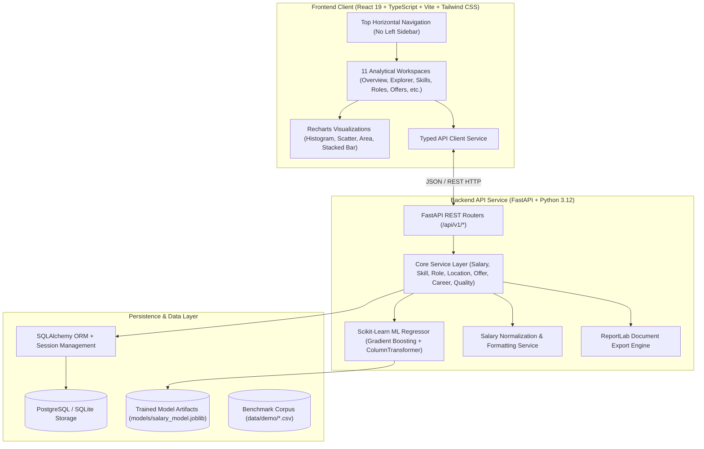
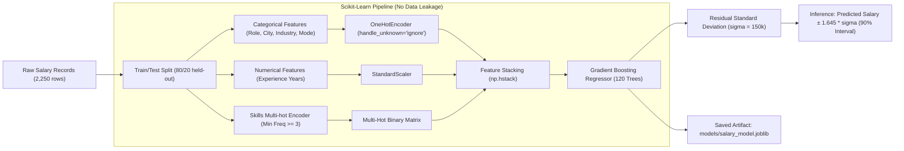
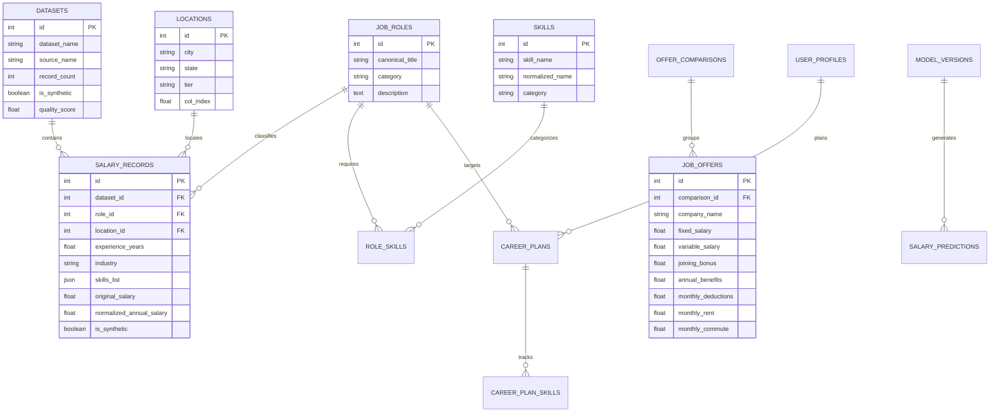

# SALVERA — System Architecture & Technical Design

## 1. High-Level Architecture Overview

SALVERA adopts a decoupled, multi-tier full-stack architecture tailored for high performance, local offline execution, and statistical rigor:

---

## 2. Machine Learning Regression Pipeline

---

## 3. Relational Database Schema (SQLAlchemy / PostgreSQL)

---

## 4. Key Architectural Trade-offs & Decisions

1. **Dual Database Engine (SQLite default with native PostgreSQL support):**
   - *Decision:* Configured SQLAlchemy to default to local SQLite (`data/salvera.db`) with zero manual server setup while fully supporting PostgreSQL via `DATABASE_URL`.
   - *Rationale:* Ensures Windows developers, interviewers, and evaluators can clone and run `run.bat` instantly without spinning up PostgreSQL services.

2. **ColumnTransformer + Multi-Hot Encoding for Skills:**
   - *Decision:* Replaced naive one-hot encoding with a dedicated `MultiHotSkillEncoder` that parses delimited skill strings, filters rare tokens, and fits vocabulary exclusively on training records.
   - *Rationale:* Eliminates data leakage and avoids sparse dimension explosions.

3. **Residual Prediction Intervals over Hardcoded Percentages:**
   - *Decision:* Computed empirical residual standard deviations from test set errors to construct $z = 1.645$ (90% confidence) uncertainty bounds.
   - *Rationale:* Honors the prompt requirement to provide statistically defensible intervals rather than inventing arbitrary confidence percentages.
